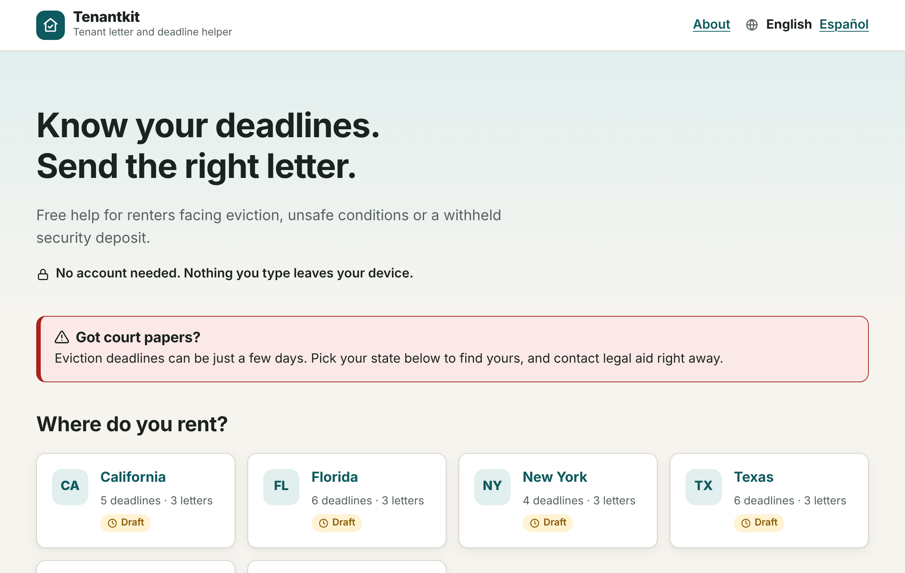
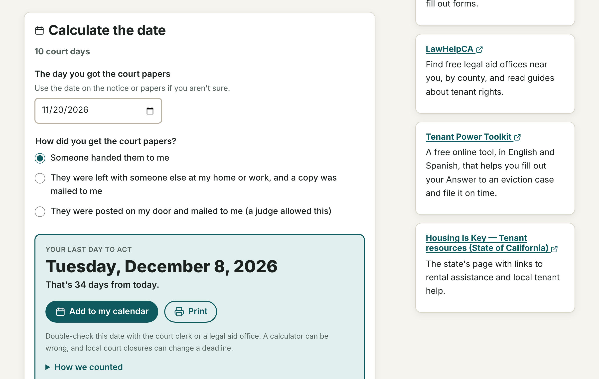
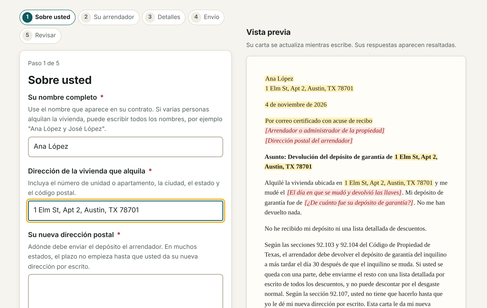
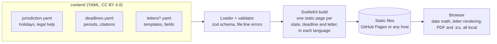

# Tenantkit

**Tenant letter and deadline helper.** Free, open-source tools that help renters facing
eviction, unsafe conditions or a withheld security deposit find their legal deadlines and
send the right letter, in English or Spanish, with no account and nothing leaving their device.

[](https://github.com/lobojoel2003/Tenantkit/actions/workflows/ci.yml)
[](https://github.com/lobojoel2003/Tenantkit/actions/workflows/deploy.yml)
[](https://github.com/lobojoel2003/Tenantkit/actions/workflows/codeql.yml)
[](https://github.com/lobojoel2003/Tenantkit/releases/latest)
[](LICENSE)
[](content/LICENSE.md)

**Live site:** https://lobojoel2003.github.io/Tenantkit/



> **Not legal advice.** Tenantkit explains the law in plain language and does the date math,
> but it can't know everything about someone's situation, and laws change. Every state is
> labeled **draft** until a lawyer licensed there reviews it.

## Contents

- [Why Tenantkit](#why-tenantkit)
- [What it does](#what-it-does)
- [Coverage](#coverage)
- [How it works](#how-it-works)
- [Getting started](#getting-started)
- [Add your state](#add-your-state)
- [Project layout](#project-layout)
- [Privacy and security](#privacy-and-security)
- [Accessibility and languages](#accessibility-and-languages)
- [Deployment](#deployment)
- [Versions, builds and releases](#versions-builds-and-releases)
- [CI/CD](#cicd)
- [Contributing](#contributing)
- [License](#license)
- [Acknowledgements](#acknowledgements)

## Why Tenantkit

Renters facing eviction, unsafe conditions or a withheld deposit often miss a deadline or never
send the letter that would protect them. Most go to court without a lawyer.

- About **3% of tenants** have a lawyer in eviction cases, compared with **81% of landlords**
  (National Coalition for the Civil Right to Counsel, cited by
  [Next City](https://nextcity.org/urbanist-news/tech-tools-aim-to-help-tenants-fight-eviction), 2021).
- **Free tools work when they exist.** LA's Tenant Power Toolkit is used by about 500 tenants a
  month, around 10% of the county's eviction filings, and lowered default rates
  ([Planetizen](https://www.planetizen.com/news/2025/06/135365-tech-tools-help-tenants-push-back-against-problematic-landlords), 2025).
- **Existing tools are tied to one city or state**, such as JustFix (New York) and Hello Landlord.
  Housing advocates say language and tech-access barriers "leave a huge portion of renters out"
  ([Next City](https://nextcity.org/urbanist-news/tech-tools-aim-to-help-tenants-fight-eviction)).

**The gap Tenantkit fills:** a reusable engine where each state's rules and letter templates
live as plain data files that local legal aid groups and volunteers can add to, instead of one
more city-only site.

## What it does

|                                                                                                    |                                                                                                   |
| -------------------------------------------------------------------------------------------------- | ------------------------------------------------------------------------------------------------- |
|  |  |
| **Deadline calculator.** Enter a date and get the last day to act.                                 | **Letter wizard.** Answer a few questions and download a ready-to-send PDF.                       |

**Deadline calculator**

- Counts calendar days, **court days** (skipping weekends and each state's court holidays),
  months or hours, following the usual legal rule: the first day doesn't count, the last day does.
- Asks the questions that change a deadline, such as how court papers were delivered.
- Shows **how the date was counted**, day by day, including every holiday it skipped.
- Adds the deadline to a phone calendar (`.ics`) with reminders, or prints it.
- Explains what the deadline means, what happens if it passes, what to do now, and links to the law.

**Letter wizard**

- Repair requests, security deposit demands and payment-plan letters, with state-specific legal
  paragraphs that cite the statute and compute dates (for example, "your 21-day deadline was
  October 22, 2026").
- Step-by-step questions with validation and a **live preview** that highlights the answers.
- The **letter language is separate from the site language**: a Spanish-speaking tenant can use the
  site in Spanish and send the letter in English.
- **PDF** (made in the browser with [pdf-lib](https://pdf-lib.js.org/)), print, copy or plain text.
- Delivery tips and a checklist of what to keep.

**For everyone**

- No account, no tracking, no cookies. Answers are saved in the browser only if the person asks.
- Works on any phone, in English and Spanish, with keyboard and screen reader support.
- Free legal help for each state, and every rule links to its source.

## Coverage

| State             | Deadlines | Letters | Status | Highlights                                                                       |
| ----------------- | --------: | ------: | ------ | -------------------------------------------------------------------------------- |
| California        |         5 |       3 | Draft  | 3-day notice, 10-court-day eviction response (AB 2347), 21-day deposit return    |
| Florida           |         6 |       3 | Draft  | 3-day notice, 5-day answer and rent deposit, deposit claim and 15-day objection  |
| New York          |         4 |       3 | Draft  | 14-day rent demand, NYC Housing Court answer, 14-day deposit statement           |
| Texas             |         6 |       3 | Draft  | Notice to vacate and right to pay late rent (SB 38, 2026), 5-day appeal          |
| Washington        |         4 |       3 | Draft  | 14-day pay or vacate, repair start times (24 h / 72 h / 10 days), 30-day deposit |
| Other U.S. states |         — |       3 | Draft  | General letters that work anywhere                                               |

**Draft** means the rules were written by volunteers from official sources and haven't yet been
reviewed by a lawyer licensed in that state. A legal aid office or attorney can review a state
and mark it `reviewed`; see [CONTRIBUTING.md](CONTRIBUTING.md#reviewing-a-state).

## How it works



1. **Content is data.** Each state is a folder of YAML files: deadlines with periods and citations,
   court holidays written as rules ("4th Thursday of November"), legal help, and letters that
   extend shared templates. A small, logic-free template language (`{{name}}`,
   `{{#if urgent}}…{{/if}}`) fills in answers.
2. **The build checks everything.** A loader validates every file against the schema, checks that
   templates only use names that exist, that translations are complete and use the same
   placeholders, and that references between files resolve, and reports problems with file and
   line numbers. A broken file fails the build.
3. **Every page is prerendered.** SvelteKit with `adapter-static` writes one HTML page per state,
   topic, deadline and letter in each language. There is no server and no database.
4. **The browser does the rest.** Deadline counting, letter rendering, PDF and calendar files all
   run on the device.

More detail: [docs/ARCHITECTURE.md](docs/ARCHITECTURE.md).

## Getting started

Requirements: [Node.js](https://nodejs.org/) 22 or newer.

```bash
git clone https://github.com/lobojoel2003/Tenantkit.git
```

```bash
cd Tenantkit && npm install
```

```bash
npm run dev
```

Then open http://localhost:5173.

| Command                    | What it does                                                        |
| -------------------------- | ------------------------------------------------------------------- |
| `npm run dev`              | Start the dev server with live reload (content changes included)    |
| `npm run build`            | Build the static site into `build/`                                 |
| `npm run preview`          | Serve the built site locally                                        |
| `npm run serve`            | Serve `build/` the way GitHub Pages does (used by end-to-end tests) |
| `npm run content:validate` | Check every content file (strict: warnings fail too)                |
| `npm run content:schema`   | Regenerate the JSON Schemas in `schema/`                            |
| `npm run lint`             | Prettier and ESLint                                                 |
| `npm run format`           | Format all files                                                    |
| `npm run check`            | Type-check TypeScript and Svelte                                    |
| `npm run test:unit`        | Unit tests (Vitest)                                                 |
| `npm run test:coverage`    | Unit tests with a coverage report                                   |
| `npm run test:e2e`         | End-to-end and accessibility tests (Playwright; run `build` first)  |
| `npm run verify`           | Lint, type-check, validate content, unit tests and build            |

The first time you run end-to-end tests, install a browser with
`npx playwright install chromium`.

## Add your state

You don't need to write code. Copy a state folder, edit the YAML, run the checker and open a pull
request. The **[content guide](content/README.md)** explains every file, the template language,
holidays and translations, with examples.

```bash
cp -r content/jurisdictions/us-wa content/jurisdictions/us-or
```

```bash
npm run content:validate
```

Editors such as VS Code (with the YAML extension) use the schemas in `schema/` to autocomplete
keys and underline mistakes as you type. This repository's `.vscode/settings.json` sets that up.

## Project layout

```text
content/                 Rules, letters and holidays (CC BY 4.0) — see content/README.md
schema/                  JSON Schemas generated from the content schema
src/
  lib/engine/            Pure TypeScript: dates, holidays, deadlines, templates, loader
  lib/pdf/               PDF letters with pdf-lib
  lib/i18n/              Interface translations (en.json, es.json) and helpers
  lib/components/        Svelte components (calculator, wizard, preview, …)
  lib/server/content.ts  Loads content at build time
  routes/                Pages: /[lang]/[state]/[topic]/, /deadlines/[id]/, /letters/[id]/
scripts/                 Content validator, schema generator, release tooling
tests/unit/              Vitest unit tests
tests/e2e/               Playwright end-to-end and accessibility tests
docs/                    Architecture and release notes for maintainers
```

## Privacy and security

- **No server, no accounts, no analytics, no cookies.** The site is static files.
- **Nothing typed leaves the device.** Letters, PDFs and calendar files are made in the browser.
- **A strict Content Security Policy** (`connect-src 'self'`, no third-party scripts, fonts or
  images) is set on every page, so the site can't contact another server even by mistake. An
  end-to-end test fails if any page tries.
- **Saving answers is opt-in** and uses only the browser's local storage, with a clear button.
- **Templates can't run code.** The letter language only produces text.

Found a security problem? See [SECURITY.md](SECURITY.md).

## Accessibility and languages

- Semantic HTML, labeled form fields, visible focus, skip link, large tap targets, reduced-motion
  support, dark mode and print styles. Every build runs [axe](https://github.com/dequelabs/axe-core)
  checks for WCAG 2.1 AA on key pages.
- **English and Spanish from day one.** Interface text lives in `src/lib/i18n/locales/*.json`, and
  content text sits next to the English in each YAML file. Tests fail if a translation is missing
  or uses different placeholders. To add a language, see
  [docs/ARCHITECTURE.md](docs/ARCHITECTURE.md#adding-a-language).

## Deployment

Tenantkit builds to plain static files, so it can be hosted anywhere.

**GitHub Pages (this repository).** The [Deploy workflow](.github/workflows/deploy.yml) builds the
site with the right base path and publishes it on every push to `main`. Turn Pages on once:
**Settings → Pages → Build and deployment → Source: GitHub Actions**. Until then the workflow
finishes with a warning instead of deploying.

**Any static host.** Download `tenantkit-site-vX.Y.Z.zip` from a
[release](https://github.com/lobojoel2003/Tenantkit/releases) and upload it, or build it yourself:

```bash
npm run build
```

To serve from a sub-folder, set its path when building, for example
`BASE_PATH=/tenantkit npm run build`. Configure the host to serve `404.html` for missing pages.

## Versions, builds and releases

- **Semantic versioning.** The version in `package.json` follows [SemVer](https://semver.org/):
  breaking changes to the content format bump the major version, new states and features the
  minor version, fixes the patch version. Every content file also carries `schema_version`.
- **Build numbers.** Each build is stamped with its version, build number (the commit count, so
  the same commit always gets the same number) and commit hash. They appear in the site footer
  and in [`/build-info.json`](https://lobojoel2003.github.io/Tenantkit/build-info.json).
- **Changelog.** Every release is described in [CHANGELOG.md](CHANGELOG.md).
- **Releases.** Pushing a tag like `v1.2.0` runs the [Release workflow](.github/workflows/release.yml):
  it runs the full CI suite, checks the tag matches `package.json`, and publishes a GitHub release
  with the changelog notes and these files:

  | File                             | Contents                                                   |
  | -------------------------------- | ---------------------------------------------------------- |
  | `tenantkit-site-vX.Y.Z.zip`      | The static website, ready to host                          |
  | `tenantkit-content-vX.Y.Z.zip`   | Rules, letters, holidays and schemas (CC BY 4.0) for reuse |
  | `tenantkit-sbom-vX.Y.Z.cdx.json` | Software bill of materials (CycloneDX)                     |
  | `SHA256SUMS.txt`                 | Checksums                                                  |

  Each file has a signed build provenance attestation. Maintainers: see
  [docs/RELEASING.md](docs/RELEASING.md).

## CI/CD

| Workflow                                 | When                          | What it does                                                                                                                                                         |
| ---------------------------------------- | ----------------------------- | -------------------------------------------------------------------------------------------------------------------------------------------------------------------- |
| [CI](.github/workflows/ci.yml)           | Pull requests, pushes to main | Prettier, ESLint, type-check, content validation, schema freshness, unit tests with coverage, build, Playwright end-to-end and accessibility tests, dependency audit |
| [Deploy](.github/workflows/deploy.yml)   | Pushes to main                | Builds and publishes the site to GitHub Pages                                                                                                                        |
| [Release](.github/workflows/release.yml) | Tags `vX.Y.Z`                 | Full CI, then packages and publishes a GitHub release with attestations                                                                                              |
| [CodeQL](.github/workflows/codeql.yml)   | Pull requests, main, weekly   | Static security analysis of the code and workflows                                                                                                                   |
| [Dependabot](.github/dependabot.yml)     | Weekly                        | Grouped dependency and GitHub Actions updates                                                                                                                        |

Content problems show up as annotations on the exact line of the pull request's YAML file.

## Contributing

Contributions of every kind are welcome: a new state, a correction, a translation, a review by a
licensed attorney, or code. Start with [CONTRIBUTING.md](CONTRIBUTING.md). Please follow the
[Code of Conduct](CODE_OF_CONDUCT.md).

**If you need legal help, please don't open an issue.** Use the free legal help listed for your
state on the site, or find legal aid at [LawHelp.org](https://www.lawhelp.org/).

## License

Tenantkit has two licenses, so that the app stays open while legal aid groups can freely copy
and adapt the templates:

- **Code** (everything outside `content/` and `schema/`): [GNU Affero General Public License v3.0](LICENSE)
  (`AGPL-3.0-only`). If you run a modified version as a website, you must share its source code.
- **Content** (`content/`: letter templates, deadline rules, fieldsets and holiday calendars, and
  the generated `schema/`): [Creative Commons Attribution 4.0 International](content/LICENSE.md)
  (`CC-BY-4.0`). Copy, adapt and republish them, including in other tools, with credit:

  > Based on Tenantkit content (https://github.com/lobojoel2003/Tenantkit), licensed under CC BY 4.0.

## Acknowledgements

Tenantkit stands on the work of tenant advocates and earlier tools, including
[Docassemble](https://docassemble.org/) (guided interviews from data files),
[JustFix](https://www.justfix.org/) and the
[Tenant Power Toolkit](https://tenantpowertoolkit.org/). The deadlines and letters were drafted
from official statutes, court rules and legal aid guides linked in each file.
